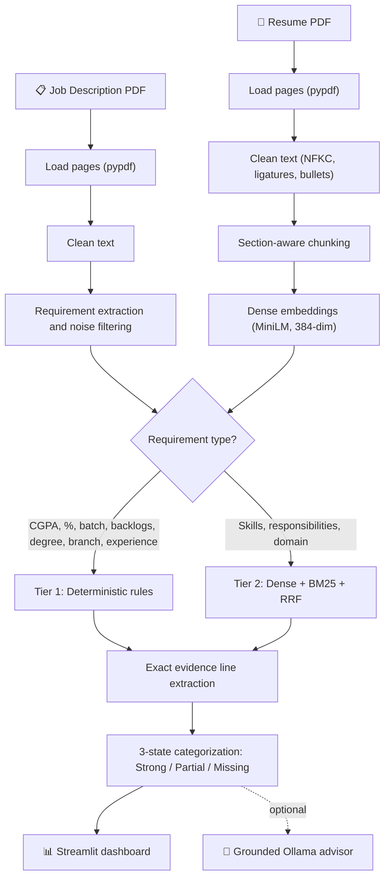

<div align="center">

# 🎯 Career Intelligence RAG

**Evidence-grounded resume analysis, requirement matching and career compatibility, with no black-box scores.**

A two-tier engine that checks hard eligibility rules *deterministically* and skills with *hybrid dense + sparse retrieval*, then cites the exact resume line behind every verdict. Runs 100% locally.


[Why this exists](#-why-this-exists) · [Architecture](#-architecture) · [Features](#-key-features) · [Quick start](#-quick-start) · [How it works](#-how-it-works) · [Limitations](#-known-limitations) · [Roadmap](#-roadmap)

</div>

---

## 💡 Why this exists

Most resume matchers fail in one of two ways:

| Failure mode | What goes wrong |
|---|---|
| **Semantic over-generalization** | Dense embeddings measure topical closeness, not facts. A resume with `CGPA: 5.2` and one with `CGPA: 8.6` score almost the same against *"Minimum CGPA 6.0"*, because both talk about academics. |
| **LLM hallucination and opaque scoring** | Pasting a whole resume into a prompt and asking *"does this candidate match?"* gives invented skills, unexplainable numbers, and extra latency or API cost. |

**Career Intelligence RAG** splits the problem. Facts that have a right answer (CGPA, backlogs, batch year, degree, branch) go to a rule engine. Skills and responsibilities go to hybrid retrieval. Every verdict comes with the supporting sentence, section and page number, so a human can audit it in seconds.

> The LLM never scores the resume. Matching, classification and coverage are fully deterministic and retriever-driven. Ollama is only used for the optional career-advice chat.

---

## 🏗️ Architecture



---

## ✨ Key Features

| | Feature | Details |
|---|---|---|
| 📄 | **Page-aware PDF ingestion** | Extracts resumes and JDs page by page with `pypdf`, keeping page numbers for citations. Accepts PDF or TXT up to 10 MB. |
| 🧹 | **Typography cleaning** | NFKC normalization fixes ligatures (`fi → fi`), standardizes bullets, strips page headers and rebuilds broken line wraps. |
| 🏷️ | **Section-aware chunking** | Splits into Skills, Projects, Education, Experience and Summary, then breaks skills and projects into atomic, page-tagged chunks. |
| 🎯 | **Noise-stripping JD parser** | Removes company marketing, benefits and EEO boilerplate, and splits compound lines like *"Programming in Java, C++, Python"* into separate requirements. |
| 🔢 | **Deterministic eligibility** | Regex and rule logic for CGPA, percentage, graduation batch, active backlogs, degree and branch. `8.63 ≥ 6.0` is computed, not guessed. |
| ⚡ | **Hybrid retrieval** | Dense cosine similarity plus BM25Okapi, fused with Reciprocal Rank Fusion (`k = 60`). |
| 🔤 | **Symbol-safe tokenizer** | Protects `C++`, `C#` and `.NET` from tokenizers that reduce them to `c`. |
| 🔍 | **Exact evidence isolation** | Returns the single supporting sentence instead of a whole paragraph. |
| 🛡️ | **Privacy first** | Local embeddings and a local Ollama model. No candidate data leaves your machine. |
| 🖥️ | **Interactive dashboard** | Five metric cards, status badges, expandable evidence panels and an AI career coach tab. |

---

## 🔬 How it works

### Tier 1: Deterministic structured eligibility

Requirements that have a factual answer never touch the vector index.

| Check | Behaviour |
|---|---|
| **CGPA** | Extracts the required and candidate values, normalizes a 4.0 scale to 10.0 when needed, then compares numerically. |
| **Percentage** | Numeric comparison against the academic cutoff. |
| **Graduation batch** | Needs explicit batch or graduation context. It will not infer a year from project dates. |
| **Active backlogs** | Strict: missing text is **not** assumed to mean zero backlogs. |
| **Degree** | Alias mapping (`b.tech`, `bachelor of technology`, `be`, `mca`, …). |
| **Branch** | Alias mapping (`cse`, `computer science`, `ise`, `information science`, …). |
| **Experience** | Years of experience and campus-hiring checks. |

Example: *"Minimum Academic Score: CGPA 6.0 / 60% and above"* against *"Bachelor of Engineering CGPA - 8.63"* returns:

```python
{
    "status": "STRONG EVIDENCE",
    "match_method": "structured_numeric",
    "score": 1.0,
    "candidate_value": 8.63,
    "required_value": 6.0,
    "evidence_text": "Education: Bachelor of Engineering CGPA - 8.63",
}
```

### Tier 2: Hybrid dense + sparse RAG

For skills and responsibilities, each requirement is searched two ways and the rankings are fused:

```
RRF(d) = Σ  w_m / (k + rank_m(d))        k = 60,  w_dense = w_bm25 = 1.0
```

| Retriever | Strength |
|---|---|
| **Dense** (`all-MiniLM-L6-v2`, NumPy cosine) | Understands paraphrase and related concepts. |
| **Sparse** (`BM25Okapi`) | Catches exact tool names and keywords. |

### Evidence states

| Status | Condition |
|---|---|
| ✅ **STRONG EVIDENCE** | Cosine ≥ 0.40, **or** exact keyword in the chunk with cosine ≥ 0.25, **or** structured rule satisfied. |
| 🟡 **PARTIAL / RELATED** | Cosine 0.30 to 0.39, **or** a BM25 keyword hit. |
| ❌ **MISSING / UNVERIFIED** | Cosine < 0.30 with no keyword hit, rule failure, or unverifiable fact. |

### Overall match coverage

```
Coverage = (1.0 × Strong + 0.5 × Partial + 0.0 × Missing) / Total × 100
```

Thresholds and weights live in [`app/rag/config.py`](app/rag/config.py).

### Every result is citable

Each match carries the exact sentence, resume section, PDF page, score, match method (`structured_numeric`, `structured_eligibility`, `structured_degree`, `structured_branch`, `structured_experience`, `hybrid_rrf`, `semantic_dense`), and the candidate and required values for structured checks.

---

## 🛠️ Tech stack

| Layer | Technology | Role |
|---|---|---|
| Runtime | Python 3.10+ (tested on 3.13) | Core application |
| UI | Streamlit ≥ 1.30 | Dashboard, uploaders, tabs |
| PDF | pypdf ≥ 4.0 | Page-by-page text extraction |
| Normalization | `unicodedata`, `re` | NFKC, ligatures, section and rule parsing |
| Dense retrieval | sentence-transformers ≥ 2.2.2 | `all-MiniLM-L6-v2`, 384-dim, CPU |
| Similarity | NumPy ≥ 1.24 | Vectorized cosine similarity |
| Sparse retrieval | rank-bm25 ≥ 0.2.2 | BM25Okapi keyword scoring |
| Fusion | Custom | Reciprocal Rank Fusion |
| Local LLM | Ollama SDK ≥ 0.1 + `llama3.2:3b` | Grounded career advice |
| Testing | `unittest` | 43 unit tests |

---

## 🚀 Quick start

### 1. Prerequisites

- macOS, Linux, or Windows (WSL2 recommended)
- Python 3.10 or newer
- [Ollama](https://ollama.com) installed and running, only needed for the Career Advisor tab:

```bash
ollama pull llama3.2:3b
```

### 2. Install

```bash
git clone https://github.com/vikasgjv/career-intelligence-rag.git
cd career-intelligence-rag

python3 -m venv venv
source venv/bin/activate
pip install -r requirements.txt
```

### 3. Run the tests

```bash
python -m unittest discover tests
```

### 4. Launch the dashboard

```bash
PYTHONPATH=app streamlit run app/ui.py
```

Open [http://localhost:8501](http://localhost:8501).

### 5. Or run the terminal pipeline

Uses the sample documents in `data/sample/`:

```bash
PYTHONPATH=app python app/main.py
```

---

## 🖥️ Using the dashboard

1. Upload a **resume** and a **job description** (PDF or TXT, up to 10 MB each).
2. Click **Analyze Compatibility**.
3. Read the five executive metrics, then explore the tabs:

| Tab | What you see |
|---|---|
| **1. Strong evidence** | Verified requirements with the exact supporting line, section, page and method. |
| **2. Partial evidence** | Related matches that need a closer look. |
| **3. Missing / unverified** | Requirements with no verifiable evidence in the resume. |
| **4. Career advisor** | Ask questions; `llama3.2:3b` answers using only retrieved resume evidence. |

> Tabs 1 to 3 work without Ollama. Only Tab 4 needs the Ollama daemon.

<!-- Add screenshots here:


-->

---

## 📁 Project structure

```
career-intelligence-rag/
├── app/
│   ├── rag/
│   │   ├── cleaner.py             # NFKC normalization, ligature and bullet cleaning
│   │   ├── loader.py              # PDF and text loader with page tracking
│   │   ├── chunker.py             # Section-aware resume chunking
│   │   ├── requirements.py        # JD requirement extraction and noise filtering
│   │   ├── embeddings.py          # MiniLM embedding pipeline
│   │   ├── hybrid_retriever.py    # BM25 + dense retrieval fused with RRF
│   │   ├── structured_matcher.py  # Deterministic eligibility rules
│   │   ├── retriever.py           # Two-tier matching, evidence isolation, scoring
│   │   ├── generator.py           # Grounded Ollama wrapper
│   │   └── config.py              # Thresholds, weights, model name
│   ├── main.py                    # Terminal pipeline runner
│   └── ui.py                      # Streamlit dashboard
├── data/sample/                   # Synthetic sample resume and JD (PDF + TXT)
├── tests/                         # 43 unit tests across 7 modules
├── .streamlit/config.toml         # Streamlit configuration
├── .env.example                   # Environment variable template
├── requirements.txt
└── README.md
```

---

## 🧪 Testing

43 unit tests across 7 modules:

| Module | Covers |
|---|---|
| `test_cleaner.py` | Ligatures, bullets, header spacing |
| `test_loader.py` | Text and PDF loading, byte streams, corrupt PDFs, unsupported types |
| `test_chunker.py` | Section chunking, page metadata, skill and project parsing |
| `test_requirements.py` | Boilerplate filtering, compound splitting, eligibility, soft skills |
| `test_hybrid_retriever.py` | `C++` / `C#` tokenization, BM25, dense search, RRF, reranker hook |
| `test_structured_matcher.py` | CGPA formats, cutoffs, backlogs, batch, degree, branch, experience |
| `test_retriever.py` | Cosine retrieval, evidence-line isolation, 3-state categorization |

---

## ⚖️ Known limitations

Honest trade-offs, so you know what this project does and does not do:

- **No OCR.** Text extraction relies on `pypdf`. Image-only scanned PDFs are not supported.
- **No persistent vector database.** Embeddings are in-memory NumPy arrays, recomputed every run. There is no Chroma, FAISS or similar.
- **Reranker is a hook only.** `HybridRetriever` accepts a `reranker` callback, but no cross-encoder model is loaded.
- **No retrieval benchmarks yet.** The unit tests cover logic, but Precision@K, Recall@K, MRR and RAGAS-style faithfulness scores are not implemented.
- **Backlog strictness.** If a resume does not explicitly state its backlog count, the check returns *Unverified*, even though many candidates with zero backlogs never write it down.
- **First-match degree and branch.** For dual-degree candidates, the first matching alias wins, which can cause a false miss.
- **CGPA scales.** Only 4.0 → 10.0 conversion is supported. Other scales (for example 5.0 or inverse grading systems) are not.
- **Ollama errors are not handled gracefully.** If the daemon is stopped or the model is not pulled, Tab 4 raises an exception instead of a friendly message.
- **Evidence lines are single sentences.** Context spread over two adjacent sentences can be lost.
- **CPU-only embeddings.** The device is hardcoded to `cpu`.

---

## 🗺️ Roadmap

- [ ] OCR fallback for scanned PDFs
- [ ] Cross-encoder reranking (for example `ms-marco-MiniLM`)
- [ ] Persistent vector store for cross-session and batch use
- [ ] Evaluation suite with Precision@K, Recall@K and faithfulness metrics
- [ ] Graceful Ollama error handling and config-driven model name
- [ ] PDF / CSV report export
- [ ] More academic grading scales

---

## 🤝 Contributing

Issues and pull requests are welcome. Please run `python -m unittest discover tests` before submitting changes.

## 👤 Author

Built by [**vikasgjv**](https://github.com/vikasgjv).

---

<div align="center">

*If this project helped you, consider giving it a ⭐*

</div>
